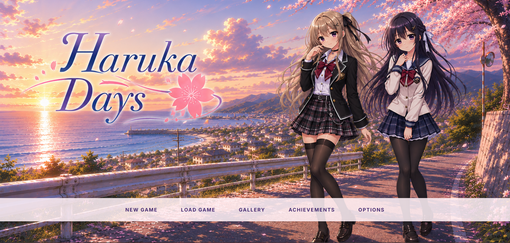
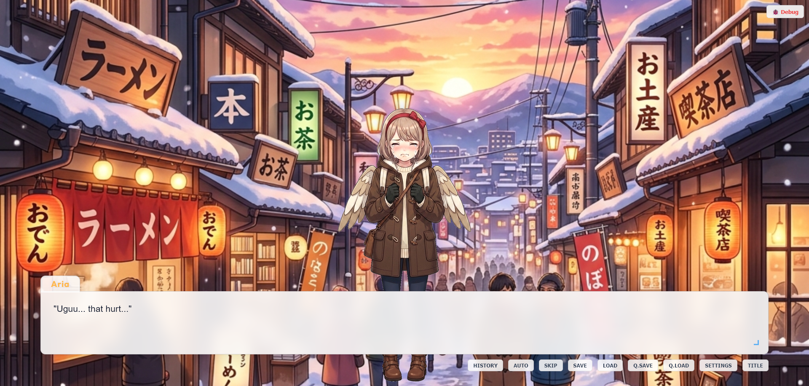
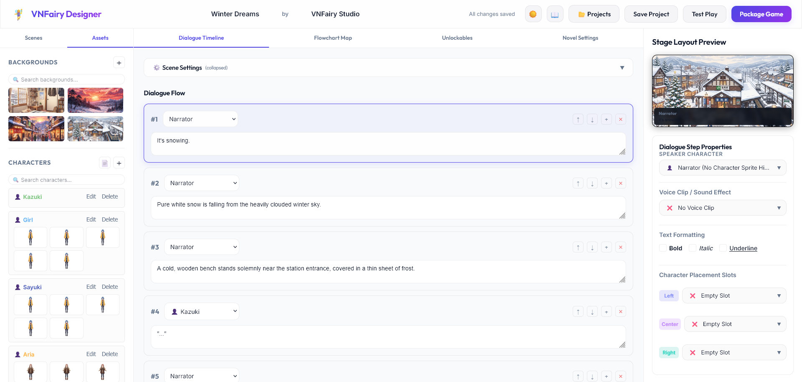
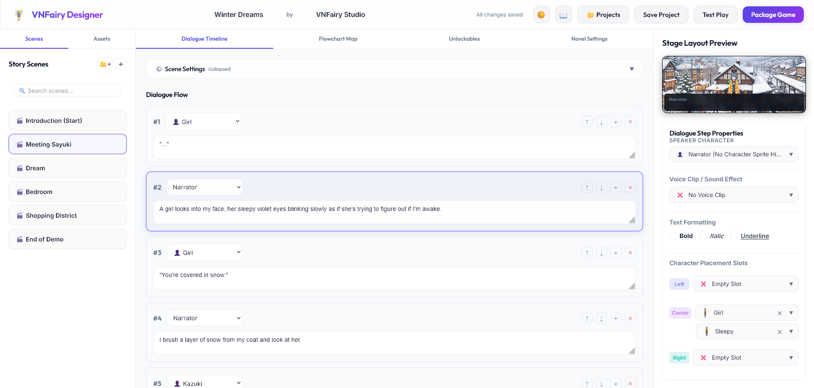
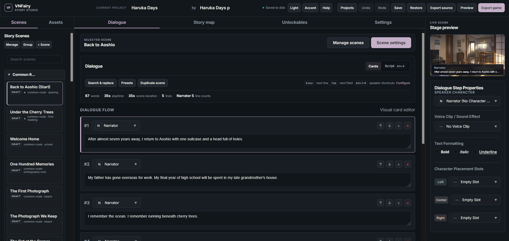
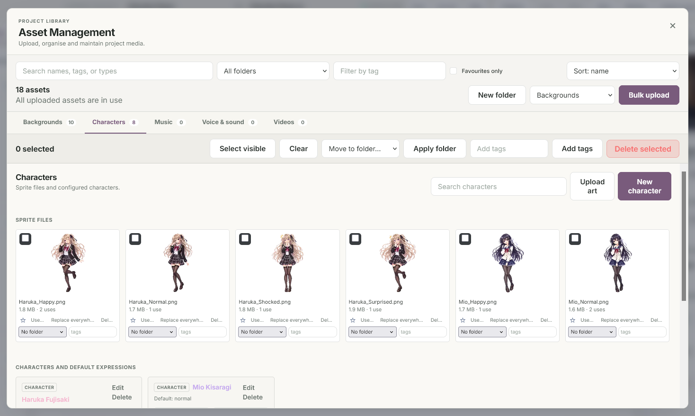

# VNFairy

**A lightweight visual novel engine and designer that runs in your browser.**

VNFairy lets you create, design, play, and package visual novels in your browser. The Designer and Player can run on static hosting or use the optional Node server.

**Current release: 2.0.0**

[Open the Designer](https://coderkei.github.io/vnfairy/app/editor.html) · [Open the Player](https://coderkei.github.io/vnfairy/app/) · [Read the visual docs](https://coderkei.github.io/vnfairy/) · [Download a release](https://github.com/coderkei/VNFairy/releases) · [Report an issue](https://github.com/coderkei/VNFairy/issues)

## Screenshots

<p align="center">
  
  
</p>
<p align="center">
  
  
</p>
<p align="center">
  
  
</p>

More interface and player views are available in the [screenshots](screenshots) folder.

## Quick start

### Run on static hosting

Open the hosted Designer or Player using the links above. To publish your own copy on GitHub Pages, set **Settings → Pages → Source** to **GitHub Actions** and run the [Pages workflow](.github/workflows/pages.yml). It publishes the docs at the site root and the app under `app/`. On other static hosts, serve the repository's frontend files and open `editor.html` for the Designer or `index.html` for the Player.

- **Folder storage:** On HTTPS or localhost, a browser with folder access offers **Choose folder**. Select a dedicated folder to hold your stories. VNFairy saves a project subfolder with `project.json` and media under `assets/` in that folder. If permission expires, use **Reconnect folder**.
- **Browser storage:** In Firefox and other browsers without the folder picker, projects and media are saved in the current browser. Use **Import .vnfairy** and **Export source** to back up your work or move it between browsers, folders, and the Node server. Clearing site data removes projects stored in the browser.
- **Playback:** Use **Preview** or open the separate Player on the same site to play stories from the active workspace. **Export game** creates a playable ZIP for sharing. **Export source** creates an editable archive.

Switching storage changes which stories you see. To move an existing story, export it before switching, then import it in the destination workspace.

### Run static mode locally

With Python 3 installed, open a terminal in the VNFairy folder and run:

```powershell
python -m http.server 8000 --bind 127.0.0.1
```

Use `python3` if that is how Python 3 is installed on your system. The command serves the files on your own computer and requires no Node installation or build step.

Open [Designer](http://127.0.0.1:8000/editor.html) or [Player](http://127.0.0.1:8000/) while the terminal is running. The Designer starts in browser storage. Use **Choose folder** if your browser offers it, or use **Import .vnfairy** and **Export source**. Keep using the same address and port to see the same browser workspace. Press **Ctrl+C** in the terminal to stop serving.

### Run the optional Node server

Requires [Node.js](https://nodejs.org/) v16 or newer.

```bash
git clone https://github.com/coderkei/VNFairy.git
cd VNFairy
npm install
node server.js
```

Then open one of these URLs:

| URL | Purpose |
|-----|---------|
| `http://localhost:3000/` | Play visual novels with the VNFairy Player |
| `http://localhost:3000/editor.html` | Create and edit projects in the VNFairy Designer |

The server binds to `127.0.0.1` on port `3000` by default and creates a demo project at `data/projects/demo/` on first run. VNFairy uses the server when it detects it, and you can switch storage from the dashboard. Server mode also keeps recovery snapshots. Use custom values when needed:

```bash
node server.js --port=8080 --host=192.168.1.100
```

## The authoring workflow

1. **Create a project** in the multi-project dashboard.
2. **Manage assets** such as backgrounds, character sprites, music, voice clips, sound effects, and videos.
3. **Write dialogue** in Cards or Script view, with speakers, formatting, audio, and character placement.
4. **Map the story** with scenes, groups, choices, conditional jumps, and typed project variables.
5. **Preview and debug** the novel in a new player tab, including optional scene and unlockable tools.
6. **Export the game** as a self-contained ZIP for static hosting or offline playback.

## Features

### Storytelling

- **Scenes and groups** — Organise a story into reusable scenes and route it linearly or through player choices.
- **Branching logic** — Add conditional jumps and multi-condition choice rules backed by boolean, number, text, or inventory variables.
- **Dialogue authoring** — Use Cards or Script view with search and replace, bulk speaker assignment, duplication, reordering, bookmarks, and reusable presets.
- **Narration and characters** — Assign a searchable speaker to each line, including non-visual narrators and off-stage voices.
- **Kinetic mode** — Let scenes advance without presenting interactive choices.

### Presentation and audio

- **Characters** — Place sprites left, centre, or right with per-line expressions and reusable pose sets.
- **Backgrounds and transitions** — Use uploaded artwork, the novel default background, or a solid background with fade and crossfade transitions.
- **Cutscenes** — Support image, video, fullscreen text, and automatically advancing text cutscenes.
- **Title screen** — Configure title artwork, music, colors, menu placement, and presentation styles.
- **Audio** — Assign background music per scene and trigger voice clips or sound effects on individual dialogue lines.

### Player experience

- **Save and load** — Use paginated browser saves stored by immutable project ID.
- **Options and controls** — Adjust text speed, skip speed, and volume; use mouse or keyboard controls.
- **Rollback** — Step back through earlier lines with the Back button, Left Arrow, or mouse wheel, including back out of choice menus.
- **Skip read text** — Skip stops at lines the player hasn't read yet (tracked per project); switch to "All Text" in Options or hold Ctrl to force-skip.
- **Gallery and achievements** — Unlock characters, backgrounds, music, and endings as players progress.
- **Standalone file playback** — Open or drag a `project.json` into the Player, or open a packaged game's `index.html` after extracting its ZIP.

### Designer and project workflow

- **Asset Management** — Search, filter, favourite, tag, sort, preview, replace, organise into virtual folders, find unused files, and apply bulk operations.
- **Scene Management** — Search, filter, group, create, duplicate, configure, bulk-update, and bulk-delete scenes.
- **Story map and settings** — See route connections and configure novel-wide presentation, variables, transitions, endings, and player behaviour.
- **Multi-project dashboard** — Create, import, duplicate, rename, archive, export, restore, and delete independent projects.
- **Reliable authoring** — Use project-wide undo/redo, explicit save status, validated saves, and recovery snapshots.
- **Source archives** — Export and import editable `.vnfairy` archives containing project configuration, scenes, and assets.
- **Test Play and Export game** — Preview without leaving the editor, then export a self-contained ZIP for any static web server.
- **Light and dark themes** — Toggle the editor theme and persist the choice across sessions.

## Project structure

```text
VNFairy/
├── index.html          # VNFairy Player
├── editor.html         # VNFairy Designer
├── server.js           # Local Node.js HTTP server and REST API
├── project-store.js    # Persistence, migrations, and recovery
├── asset-service.js    # Project-scoped asset operations
├── package-service.js   # Playable ZIP packaging
├── shared/              # Shared schema, logic, validation, and serializers
├── tests/               # Regression tests
├── docs/
│   ├── index.html       # Visual landing page
│   ├── API.md           # REST API reference
│   └── FORMAT.md        # Project and scene format reference
├── css/                 # Shared, engine, editor, and dashboard styles
├── js/                  # Player and designer logic
└── data/projects/<id>/
    ├── project.json     # Project metadata and scene index
    ├── scenes/          # One JSON file per scene
    └── assets/          # Backgrounds, sprites, audio, and videos
```

## Project artifacts and persistence

Projects and player saves carry independent metadata for their serialized format and runtime provenance:

```json
{
  "schemaVersion": 1,
  "engineVersion": "2.0.0",
  "createdWithVersion": "2.0.0"
}
```

`schemaVersion` selects an explicit migration chain. `engineVersion` identifies the runtime that last wrote an artifact, while `createdWithVersion` records the original authoring/runtime version. Legacy artifacts are migrated in memory and written through the normal validated save path. Player saves additionally include `projectId`, `projectSchemaVersion`, `savedAt`, and a nested `state` object.

See [FORMAT.md](docs/FORMAT.md) for the project and scene data model.

## Packaging and distribution

Click **Export game** in the Designer toolbar to create a self-contained `<project-id>_game.zip`. The archive includes:

- `index.html` — the standalone player
- `css/` and `js/` — engine assets
- `data/` — project data, scenes, and uploaded assets
- Per-scene `.js` wrappers for CORS-free offline playback

The archive can be hosted on GitHub Pages, itch.io, or any static web server, or extracted and opened locally. The editable `.vnfairy` source archive is separate from the playable game package and is intended for backups and moving projects between VNFairy workspaces.

## Development and testing

Install dependencies and run the dependency-free regression suite with:

```bash
npm install
npm test
```

For the complete server endpoint list, see [API.md](docs/API.md). For the serialized project and scene examples, see [FORMAT.md](docs/FORMAT.md).

## License

VNFairy is licensed under the GNU General Public License version 3, or (at your option) any later version.

A special exception permits visual novels exported using **Export game**—through the Designer or the API—to be distributed under any license, including proprietary licenses, when they include an unmodified copy of the VNFairy Player. This exception does not affect VNFairy itself or modifications to the VNFairy Player, which remain licensed under the GNU GPL.

See [LICENSE.txt](LICENSE.txt) for the full license and exception.

## Development note

This project was developed with assistance from AI language models. Some source code was generated or refined using AI, with generated code reviewed, modified, and integrated by the project author where appropriate.
